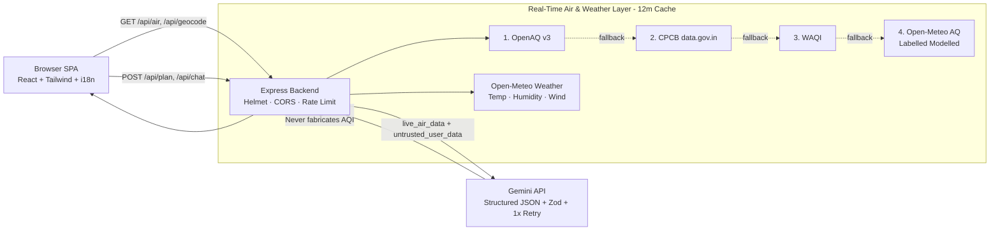
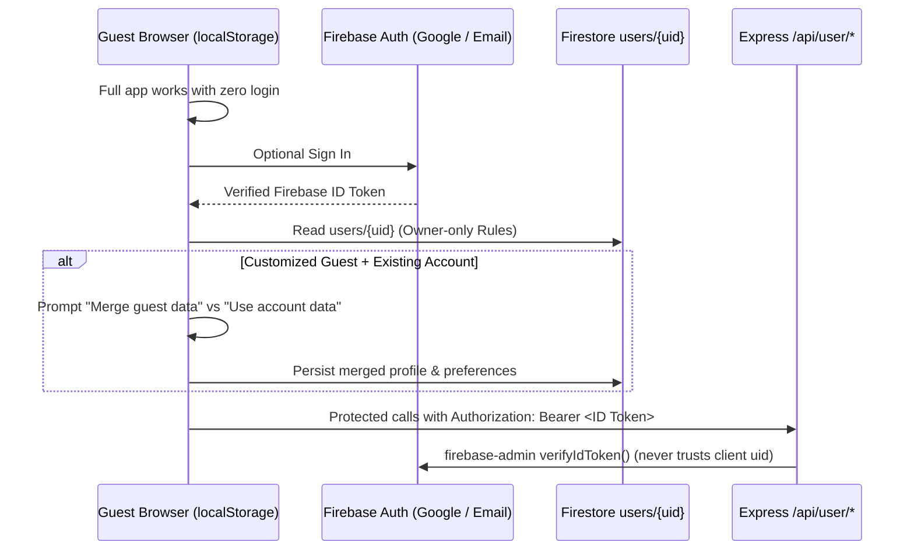
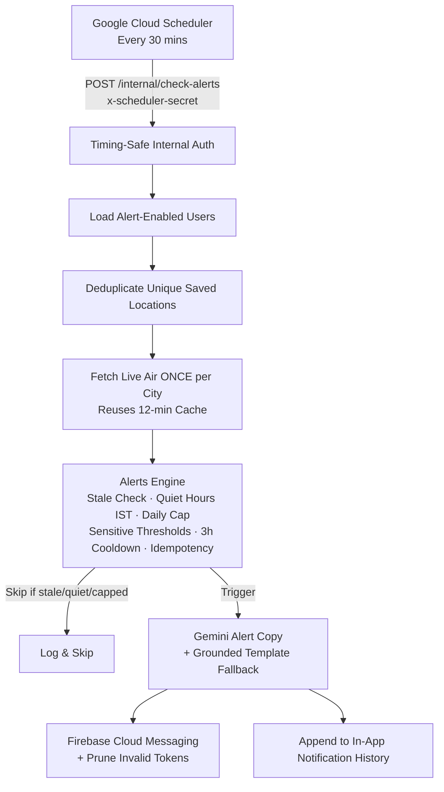

# Urban Air Quality Assistant

A production-quality, GenAI-powered **decision-support assistant** that helps families and communities across India navigate severe winter smog and urban air pollution. It combines **real-time air quality and weather data** with **household personalization** to recommend low-emission daily routines, indoor air quality actions, and sustainable alternatives — clearly explaining the *why* and *estimated impact* behind every choice.

---

## Evaluator Quick-Start (Guest Mode — Zero Login Required)

Guest Mode is enabled by default and unlocks the full decision assistant in **one click**:

1. **Open the app** (local `http://localhost:3000` or your deployed Cloud Run URL).
2. **Try a 1-click Demo Persona** on the home card (prefills household profile & city only — air quality and weather stay **100% live**):
   - *Working Commuter in Delhi* (solo car, 50 min commute, allergies)
   - *Family with 2 Kids in Mumbai* (kids' play, asthma sensitivity, standard windows)
   - *Senior Couple in Kolkata* (morning walk, elderly & respiratory sensitivity, open windows)
3. **Verify Personalization in the Same City**:
   - Pick **Delhi** via quick-pick chip or search any Indian locality (e.g., `Indiranagar`, `Jaipur`, `Patna`).
   - Generate a plan as *Working Professional · Solo Car*.
   - Change **Household type** to *Family with young children*, enable *Asthma*, enter an optional indoor PM2.5 reading (e.g. `45`), and click **Update personalized plan** — observe how the Verdict, Daily Planner, Indoor Guide, and Sustainable Swaps change for the exact same live AQI reading.
4. **Test Grounded Q&A**:
   - Ask: *"My son plays football at 5pm, is it safe today?"* or *"Should I open windows tonight?"*
   - Expand **Why this advice?** to verify live data sources, reasoning, and medical disclaimer.
5. **Test Accessibility, Hindi & Alerts**:
   - Open **Settings** -> switch to **हिन्दी (Hindi)**, toggle **Dark**, **High Contrast**, or **Extra Large** text -> changes apply instantly with screen-reader announcements.
   - Open **Settings -> Alerts & Notifications** -> click **Send test alert** -> verify the Bell badge and popover in the header.
   - Click **`?` Help** -> test the click-to-load `youtube-nocookie.com` walkthrough facade and keyboard FAQ accordion.

---

## 1. Problem Understanding

Most air-quality tools in India stop at displaying raw AQI numbers or offer generic tips ("wear a mask", "buy plants"). During winter smog episodes across the Indo-Gangetic Plain and major Indian metros, families actually need **decisions tailored to their real constraints**:
- *Should my kids play outside at 5pm or stay indoors?*
- *Should I seal my windows right now or briefly cross-ventilate at midday?*
- *If I don't own an air purifier or indoor sensor, what still reduces exposure meaningfully?*
- *How much exposure and emissions do I actually save by switching from a solo car or scooter to metro/carpool/WFH?*

**Core Architectural Principle**: Real-time environmental APIs supply **facts** (server-side, cached, never fabricated). Gemini supplies **personalized reasoning** (structured JSON output, validated with Zod, prompt-injection fenced).

---

## 2. System Architecture

### A. Live Data Fallback & Decision Engine



### B. Optional Auth, Cloud Sync & Guest-to-Account Merge



### C. Proactive 3-Layer Alerts Pipeline



---

## 3. Data Sources & Honest Limitations

| Priority | Provider | Data Type | Notes |
| --- | --- | --- | --- |
| 1 | **OpenAQ v3** | Ground monitoring stations | Optional free `OPENAQ_API_KEY` |
| 2 | **CPCB (data.gov.in)** | Official Indian CAAQMS stations | Optional free `DATA_GOV_IN_API_KEY` |
| 3 | **WAQI** | Ground stations | Optional free `WAQI_API_TOKEN` |
| 4 | **Open-Meteo Air Quality (CAMS)** | **Modelled atmospheric data** | Free, no key required. Explicitly labelled **"Modelled"** in UI with a disclosure that street-level traffic/construction smoke can be higher. |
| Parallel | **Open-Meteo Weather** | Live temp, humidity, wind | Free, no key required |
| Geocoding | **Open-Meteo Geocoding + Nominatim** | All-India locality search & reverse GPS | Restricted to India bounds (`6.5°N–37.6°N`, `68.0°E–97.5°E`). Never silently defaults to Delhi. |

**Key Guardrails**:
- **Zero Fabrication**: If all air providers fail, the backend returns HTTP `503` and the UI displays a clear error state with a Retry button.
- **No Fake Indoor Readings**: If the user does not enter an indoor monitor/purifier PM2.5 value, the Indoor Guide explicitly states indoor AQI is inferred from outdoor pollution and home setup.
- **Estimates Labelled**: Exposure reductions (%) and emission savings (kg CO₂ / PM) are always labelled as estimates with explicit assumptions.
- **Medical Disclaimer**: General environmental guidance only — not medical advice.

---

## 4. Local Setup & Environment Variables

### Prerequisites
- Node.js 22+
- A Gemini API key (`GEMINI_API_KEY`)

### Run Locally
```bash
npm install
cp .env.example .env
# Edit .env and set GEMINI_API_KEY
npm run dev
# App & API run together on http://localhost:3000
```

### Environment Variables (`.env.example`)

| Variable | Required | Default | Purpose |
| --- | --- | --- | --- |
| `GEMINI_API_KEY` | **Yes** | — | Server-side Gemini API key (never exposed to browser) |
| `GEMINI_MODEL` | No | `gemini-4-hydrogen` | Gemini model ID |
| `PORT` | No | `3000` | HTTP server port (`8080` in Cloud Run container) |
| `APP_URL` / `CORS_ALLOWED_ORIGINS` | No | `http://localhost:3000` | Allowed CORS origins |
| `OPENAQ_API_KEY` | No | `""` | Primary ground-station AQI provider |
| `DATA_GOV_IN_API_KEY` | No | `""` | Official Indian CPCB feed |
| `WAQI_API_TOKEN` | No | `""` | Secondary station feed |
| `SCHEDULER_SECRET` | For Cron | `""` | Shared secret authenticating `POST /internal/check-alerts` |
| `FIREBASE_PROJECT_ID` | No | from `firebase-applet-config.json` | Firebase Admin token verification & FCM |
| `VITE_FIREBASE_VAPID_KEY` | For Web Push | `""` | Public VAPID key from Firebase Console -> Cloud Messaging |
| `VITE_TUTORIAL_VIDEO_URL` | No | Sample YouTube URL | **Paste your walkthrough YouTube URL here** (standard `youtube.com/watch?v=...` or `youtu.be/...`) to update the Help page click-to-load video facade |
| `VITE_FEEDBACK_URL` | No | `mailto:...` | Feedback link displayed in the app footer |

> **Where to paste your tutorial video URL**: Set `VITE_TUTORIAL_VIDEO_URL="https://www.youtube.com/watch?v=YOUR_VIDEO_ID"` in `.env` (or your Cloud Run build args). The Help page automatically converts it into a privacy-enhanced click-to-load `youtube-nocookie.com` embed with a visible fallback link.

---

## 5. Deployment (Google Cloud Run, Cloud Scheduler & Firebase)

### 1. Deploy Firestore Security Rules & Enable Auth Providers
```bash
# Review firestore.rules before deploying publicly
firebase deploy --only firestore:rules
```
In Firebase Console -> **Authentication -> Sign-in method**, ensure **Google** is enabled (and optionally enable **Email/Password** for email sign-up/verification).

### 2. Deploy Full-Stack Container to Google Cloud Run
```bash
gcloud run deploy urban-air-quality-assistant \
  --source . \
  --region asia-south1 \
  --allow-unauthenticated \
  --set-env-vars "NODE_ENV=production,GEMINI_MODEL=gemini-4-hydrogen,FIREBASE_PROJECT_ID=YOUR_PROJECT_ID" \
  --set-secrets "GEMINI_API_KEY=gemini-api-key:latest,SCHEDULER_SECRET=scheduler-secret:latest"
```

### 3. Schedule Proactive Air Alerts with Cloud Scheduler (Every 30 Mins)
```bash
gcloud scheduler jobs create http check-air-alerts \
  --location asia-south1 \
  --schedule "*/30 * * * *" \
  --time-zone "Asia/Kolkata" \
  --uri "https://YOUR_CLOUD_RUN_URL/internal/check-alerts" \
  --http-method POST \
  --headers "x-scheduler-secret=YOUR_SCHEDULER_SECRET"
```

---

## 6. Testing & Code Coverage

Run the full Vitest test suite, TypeScript typecheck, and coverage report:

```bash
npm run lint           # TypeScript strict check (tsc --noEmit)
npm test               # Run all 78 unit, API & React component tests
npm run test:coverage  # Generate v8 coverage report (text + lcov)
npx eslint firestore.rules  # Validate Firestore security rules
```

### Verified Test Coverage Summary (78/78 Tests Passing Across 11 Suites)

| Layer / Module | Statements | Branches | Functions | Lines |
| --- | ---: | ---: | ---: | ---: |
| `server/config.ts` | **100.00%** | 100.00% | 100.00% | 100.00% |
| `server/middleware/internalAuth.ts` | **100.00%** | 100.00% | 100.00% | 100.00% |
| `shared/constants.ts` | **100.00%** | 100.00% | 100.00% | 100.00% |
| `server/services/dataProviders.ts` | **99.45%** | 80.59% | 100.00% | 100.00% |
| `server/services/airService.ts` | **97.47%** | 98.80% | 100.00% | 97.32% |
| `server/routes/air.ts` | **96.77%** | 80.00% | 100.00% | 96.77% |
| `server/app.ts` | **96.15%** | 96.00% | 100.00% | 96.15% |
| `server/services/usersRepo.ts` | **94.11%** | 76.47% | 100.00% | 100.00% |
| `shared/schemas.ts` | **93.15%** | 73.80% | 100.00% | 93.15% |
| `server/routes/user.ts` | **91.76%** | 64.28% | 92.85% | 91.66% |
| `server/services/geminiEngine.ts` | **90.72%** | 72.22% | 94.11% | 91.39% |
| `server/routes/internal.ts` | **89.23%** | 70.27% | 100.00% | 90.47% |
| `server/services/alertsEngine.ts` | **89.01%** | 84.21% | 87.50% | 95.23% |
| `src/i18n/I18nContext.tsx` | **96.77%** | 87.50% | 90.00% | 96.66% |
| `src/components/*` (Core Decision UI) | **55.62%–100%** | 52.98%–100% | 61.70%–100% | 56.99%–100% |

*Coverage covers all CPCB/US EPA AQI math, provider fallback & 503 failure, caching, prompt-injection sanitization, Zod retry, en/hi key parity, preference migration, Firebase Auth 401 enforcement, guest-to-account merge, alert rules (quiet hours, caps, cooldowns, stale skipping, deduplication, idempotency), Coachmark Tour keyboard/fallback, Help video facade, and core UI components.*

---

## 7. How to Use the App

1. **Choose Location**: Search any Indian city or locality, click **Use my location**, or pick a quick-pick city.
   - ``
2. **Customize Household Profile**: Select household type, commute mode/duration, outdoor habits, health sensitivities, home setup, and optional indoor PM2.5 reading.
   - ``
3. **Review Indoor & Low-Emission Guidance**: Check whether to seal or ventilate, inspect estimated CO₂/exposure savings, and ask specific schedule questions in Grounded Q&A.
   - ``
4. **Customize Preferences, Alerts & Help**: Switch English/Hindi, Dark/High-Contrast/Large Text, configure proactive smog alerts, or open the `?` Help page and 7-step tour.
   - ``

---

## 8. Privacy, Data Stored & Deletion

- **Guest Mode**: Stores only your household profile, UI preferences, tour status, and in-app alert list locally in browser `localStorage` (falls back cleanly to memory if storage is blocked).
- **Signed-In Mode**: Stores the following strictly under your private Firestore document `users/{uid}` (enforced by owner-only `firestore.rules`):
  - `profile`, `preferences`, `savedLocations` (max 5), `alertPrefs`, `alertState`, `fcmTokens` (max 10), `notificationHistory` (max 50), `createdAt`, `updatedAt`.
- **Export & Permanent Delete**: Anytime in **Settings -> Privacy & Reset**, download all stored data as JSON (**Export my account data**) or permanently delete your Firestore document, server record, and Firebase Auth account (**Delete my account and data**).

---

## 9. How to Test Alerts Locally

1. **Automatic Guest In-App Alert**: Select a city whose live CPCB AQI is currently >= 200 (or set *Asthma* in your profile to trigger from AQI >= 100). The header **Bell** badge increments immediately with severity icon, reason, and live source.
2. **UI Test Alert Button**: Open **Settings -> Alerts & Notifications** and click **Send test alert**. It populates the Notification Center (and sends a real browser Notification if granted, plus hits `POST /api/user/test-alert` when signed in).
3. **Trigger Scheduler Locally**:
   ```bash
   curl -X POST http://localhost:3000/internal/check-alerts \
     -H "x-scheduler-secret: CHANGE_ME_STRONG_RANDOM_SECRET"
   ```
   Returns JSON summary: `{ checkedUsers, uniqueLocationsFetched, alertsSent, pushDispatched, prunedTokens, skippedByReason }`.

---

## 10. AI Engineering Notes

- **AI Tools Used & Why**: Gemini (`@google/genai` SDK, model configurable via `GEMINI_MODEL`) was chosen for native structured JSON `responseSchema` enforcement, low-latency reasoning across multi-factor household constraints, and fluent English + Hindi generation.
- **Prompt Evolution**: Documented in full in [`docs/PROMPTS.md`](docs/PROMPTS.md) — evolved from free-text tips (v1) -> strict Zod-validated structured impact cards with 1x auto-retry (v2) -> XML-delimited prompt-injection fences, indoor sensor honesty, honest houseplants note, and India-specific daily routines (v3).
- **What GenAI Did vs. What Humans Designed**:
  - **GenAI handles**: Synthesizing live air/weather numbers + user household context into tailored verdicts, morning/afternoon/evening schedules, indoor actions, low-emission swaps, grounded Q&A answers, and concise alert copy.
  - **Deterministic engineering handles**: Live multi-provider data fetching & fallback chain, official CPCB/US EPA breakpoint math, 12-minute caching, strict `503` error handling, Zod schema validation & sanitization, Firebase Auth ID-token verification, Firestore owner-only security rules, IST quiet-hours/cooldown/cap/idempotent alert engine, WCAG AA accessibility, and 78 automated tests.
